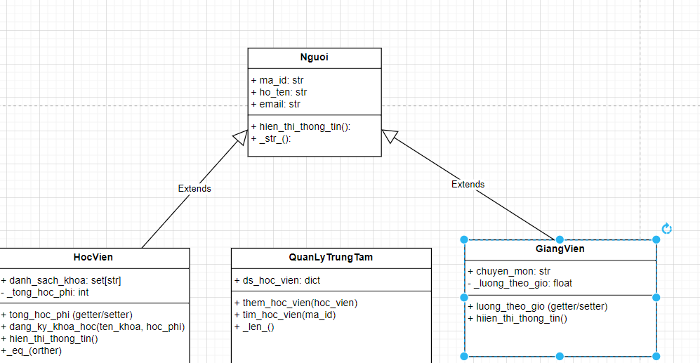
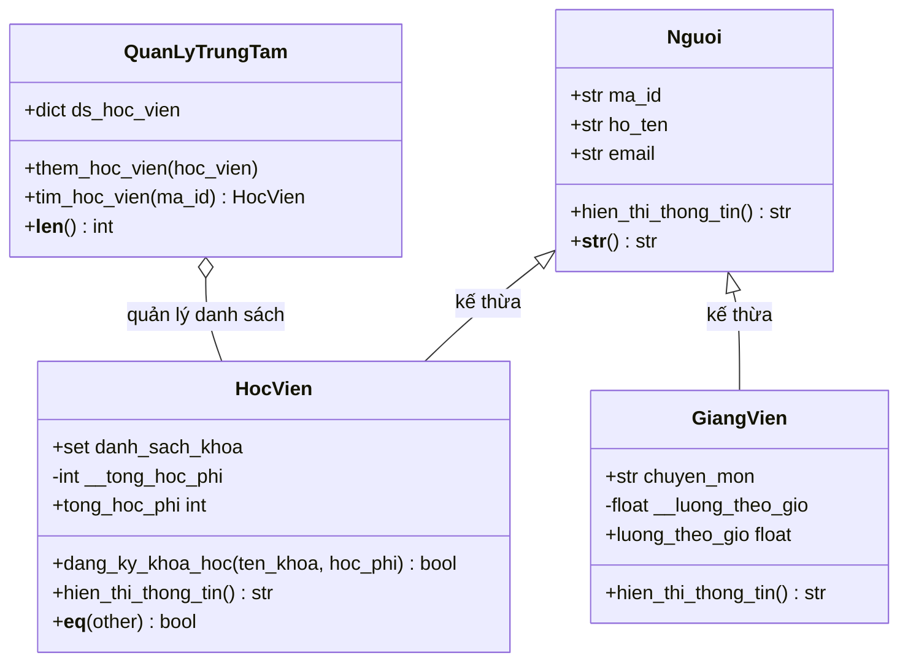

# Bài kiểm tra giữa kỳ - Lập trình Python

## Phần I: Tư duy và phân tích mã nguồn

### Câu 1.1. Bộ nhớ và biến đổi dữ liệu

#### Kết quả in ra

```text
1. list_a[0] = 99
2. list_a[1] = [20, 30, 40]
3. list_a[2] = {'a': 1, 'b': 2}
4. list_b is list_a: True
5. list_c is list_a: False
```

#### Giải thích

- `list_b = list_a` không tạo list mới. Hai biến cùng tham chiếu đến một đối tượng list. Vì vậy phép gán `list_b[0] = 99` làm `list_a[0]` cũng thành `99`.
- `copy.copy(list_a)` tạo một list ngoài mới, nhưng chỉ sao chép nông: các phần tử lồng bên trong vẫn được dùng chung. Do đó `list_c is list_a` là `False`, còn list con và dictionary tại các vị trí tương ứng vẫn là cùng đối tượng.
- `list_c[1].append(40)` sửa list con dùng chung, nên thay đổi xuất hiện khi truy cập qua `list_a`.
- `list_c[2]['b'] = 2` sửa dictionary dùng chung, nên dictionary trong `list_a` cũng nhận khóa `'b'`.
- List và dictionary là đối tượng mutable (có thể thay đổi tại chỗ). Số nguyên `10` là immutable, nhưng vị trí ngoài của list được thay bằng tham chiếu đến số nguyên mới `99`.

### Câu 1.2. Lựa chọn cấu trúc dữ liệu

1. List phải kiểm tra lần lượt các phần tử cho đến khi tìm thấy mã hoặc hết danh sách; vì vậy `id in list` có độ phức tạp trung bình và xấu nhất là `O(n)`. Set và dictionary dùng bảng băm: hàm băm ánh xạ mã tới vị trí tra cứu, nên kiểm tra thành viên trung bình là `O(1)` (trường hợp va chạm xấu có thể chậm hơn). Set phù hợp lưu tập mã duy nhất và không đảm bảo thứ tự; dictionary key cũng hỗ trợ tra cứu nhanh.
2. Dùng dictionary với `Voucher ID` làm key và phần trăm giảm giá làm value, chẳng hạn `vouchers = {"VC001": 15, "VC002": 20}`. Vì Cấu trúc này có thể vừa tra cứu mã nhanh vừa gắn mỗi mã với mức giảm tương ứng

## Phần II: Phân tích và thiết kế hướng đối tượng

### Câu 2.1. Thiết kế lớp





Ký hiệu: `+` là public; `-` là private trong sơ đồ UML. Getter/setter được biểu diễn bằng thuộc tính public tương ứng. Protected trong Python thường được ký hiệu bằng một gạch dưới.

### Câu 2.2. Đóng gói và overriding

`super().hien_thi_thong_tin()` gọi phiên bản của lớp cha `Nguoi`, do đó phần mã hiển thị mã định danh, họ tên và email được dùng lại. `GiangVien` chỉ cần nối thêm chuyên môn và lương theo giờ. Nếu không gọi `super()`, lớp con phải tự viết lại phần thông tin chung; điều này sẽ tạo mã trùng lặp, khiến việc sửa định dạng hoặc bổ sung trường ở lớp cha phải cập nhật nhiều nơi và dễ gây thiếu nhất quán.

Đóng gói `__tong_hoc_phi` và `__luong_theo_gio` hạn chế việc sửa trực tiếp thuộc tính nội bộ. Getter/setter là điểm truy cập có kiểm soát, nơi có thể kiểm tra ràng buộc trước khi cập nhật.
